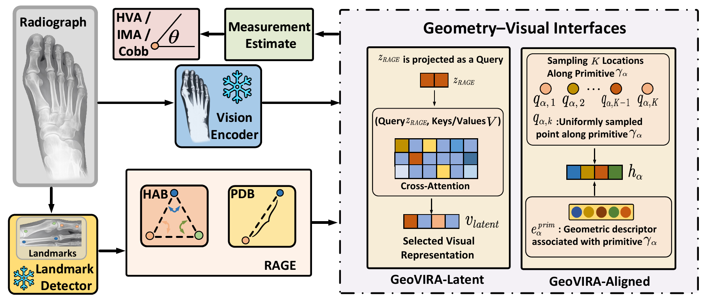
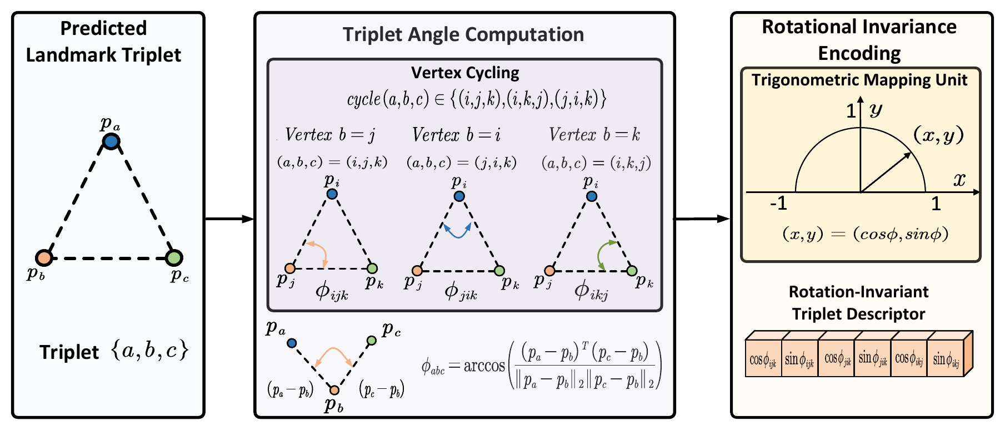

<div align="center">

<h1>GeoVIRA: Geometry–Visual Interfaces<br>for Radiographic Angle Measurement</h1>

<p>
Hongcheng Jiang<sup>1</sup> &nbsp;
Cheng Han<sup>1</sup> &nbsp;
ZhiQiang Chen<sup>1,*</sup> &nbsp;
Dianxiang Xu<sup>1</sup><br>
Caleb Grote<sup>2</sup> &nbsp;
Sherwin Chan<sup>2</sup>
</p>

<p>
<sup>1</sup> University of Missouri–Kansas City, United States<br>
<sup>2</sup> Children's Mercy Hospital, United States<br>
<sup>*</sup> Corresponding author
</p>

<p>
<a href="#main-results">Results</a> ·
<a href="#installation">Installation</a> ·
<a href="#getting-started">Getting Started</a> ·
<a href="#citation">Citation</a>
</p>

</div>

<p align="center">

</p>

**Figure 1. Overview of GeoVIRA.** A frozen landmark detector and a frozen visual encoder process the input radiograph in parallel. **RAGE** encodes the predicted landmarks through its **HAB** and **PDB** branches. **GeoVIRA-Latent** projects the RAGE representation into a query for cross-attention over frozen visual features. **GeoVIRA-Aligned** uniformly samples along predicted measurement primitives and combines the sampled visual features with their corresponding geometric descriptors. The resulting features estimate HVA, IMA, or Cobb angle. **GeoVIRA-Global** is omitted because it serves as a spatially agnostic global reference.

<details>
<summary>Higher-order angular relation construction (Figure 2)</summary>

<p align="center">

</p>

</details>

## Main Results

MAE (°) on HVAngleEst and AASCE. Values are mean ± sample standard deviation over three paired seeds; lower is better. All visual interfaces use case-matched frozen features.

| Method | HVA ↓ | IMA ↓ | Cobb ↓ |
| --- | ---: | ---: | ---: |
| RAGE (geometry only) | 3.857 ± 0.287 | 2.291 ± 0.078 | 7.186 ± 0.557 |
| GeoVIRA-Global | 3.985 ± 0.384 | 2.138 ± 0.068 | 6.057 ± 0.244 |
| GeoVIRA-Latent | 3.644 ± 0.252 | 1.991 ± 0.056 | **5.382 ± 0.179** |
| GeoVIRA-Aligned | **3.338 ± 0.081** | **1.946 ± 0.120** | 5.843 ± 0.498 |

The best matched interfaces reduce geometry-only MAE by **13.5%** (HVA), **15.1%** (IMA) and **25.1%** (Cobb). Statistical analyses are reported in the paper.

## Installation

Requires Python ≥ 3.10 and PyTorch ≥ 2.4.

```bash
git clone https://github.com/DIGiTLabHub/GeoVIRA.git
cd GeoVIRA
pip install -e .
```

## Getting Started

1. Prepare the datasets, predicted landmarks and MedImageInsight model: **[Data Preparation](docs/DATA.md)**.
2. Train RAGE and the Global, Latent or Aligned interfaces: **[Training and Evaluation](docs/EXPERIMENTS.md)**.
3. Follow the same guide for shuffled controls, relational ablations and attention correspondence analysis.

## Citation

```bibtex
@inproceedings{jiang2027geovira,
  title     = {{GeoVIRA}: Geometry--Visual Interfaces for Radiographic Angle Measurement},
  author    = {Jiang, Hongcheng and Han, Cheng and Chen, ZhiQiang and Xu, Dianxiang and Grote, Caleb and Chan, Sherwin},
  booktitle = {Proceedings of the IEEE/CVF Winter Conference on Applications of Computer Vision Workshops (WACVW)},
  year      = {2027},
  note      = {Accepted at the FABRIC Workshop, WACVW 2027}
}
```
